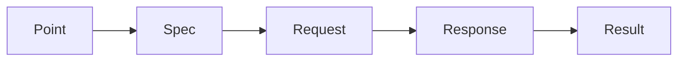

# Advanced

[Back to the README](../README.md)

Everyday use does not need this page. It explains the internals behind every
call, which matter when you write custom features.

Every SDK call runs the same five-stage pipeline:

1. **Point** — resolve the API endpoint from the operation definition.
2. **Spec** — build the HTTP specification (URL, method, headers, body).
3. **Request** — send the HTTP request.
4. **Response** — receive and parse the response.
5. **Result** — extract the result data for the caller.

A feature hook fires at each stage (e.g. `PrePoint`, `PreSpec`,
`PreRequest`), so features can inspect or modify the pipeline without
forking the SDK.

### Features

| Feature | Purpose |
| --- | --- |
| **TestFeature** | Test transport |

Pass custom features via the `extend` option at construction time.

## Customizing this SDK

This repository contains its own generator (`.sdk/`), so the SDK is
customizable without forking any upstream tool:

- **The model** (`.sdk/model/`) declares everything this project owns:
  package names, versions, active features, per-target settings. It is
  written in [aontu](https://aontu.dev), a JSON-based
  specification language designed for building ontologies: easy to edit
  by hand, and files unify rather than override, so small declarations
  compose into one model. Regeneration re-reads it every time.
- **Templates** (`.sdk/tm/`) and **components** (`.sdk/src/cmp/`) are
  the two layers of generation, copied into this repo: templates are the
  literal per-language source, components generate the API-shaped parts.
- **Regeneration overwrites.** Each run rewrites every generated file from
  the model, the templates and the components, so an edit made to
  generated output is lost. Say what this project needs in its own model
  (`.sdk/model/sdk.aontu`), or extend a target with a component of its
  own in `.sdk/src/cmp/<target>/`, registered with `registerComponent`,
  which `voxgig-sdkgen doctor` reports as an addition rather than drift.
- **Custom features and entire custom targets** arrive through sdkgen
  packages (`voxgig-sdkgen package add`), on the same rails as the
  bundled languages, and `voxgig-sdkgen doctor` reports any drift from
  what a resync would write.

How-to: [customize and propagate templates](https://github.com/voxgig/sdkgen/blob/main/docs/how-to/customize-and-propagate-templates.md).
The full story: [voxgig.com/sdk/custom](https://voxgig.com/sdk/custom).
